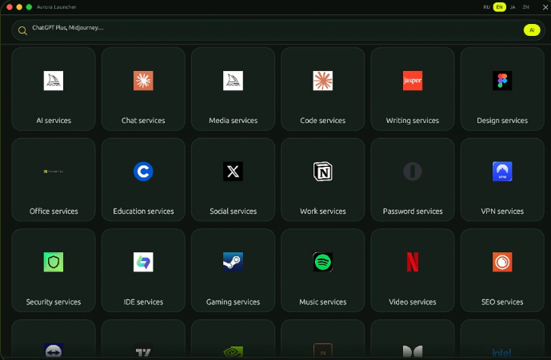

# LinkedIn Premium Career Free 2026 — InMail, who viewed you, salary insights

> **LinkedIn Premium is paid everywhere. In our Aivora launcher the same paid Career version is free.**
>
> Official site / app store = paid Career subscription. Aivora launcher = that paid Career product, free on Windows 10 / 11.

**Keywords:** LinkedIn Premium Career · LinkedIn Premium free · LinkedIn Premium windows · InMail · who viewed profile · paid LinkedIn free through launcher · Aivora Programs

Windows 10 / 11 · LinkedIn Premium Career · Social premium

The orange button opens [https://aivoraprograms.com/](https://aivoraprograms.com/). Install Aivora, then **Activate** **LinkedIn Premium**. You get the **paid Career** product **for free in our launcher**. No `LinkedInPremium.exe` in this repository.

## What LinkedIn Premium is

LinkedIn Premium Career is the paid job SKU: **15 InMail / month**, **who viewed your profile**, salary insights, **LinkedIn Learning** on the card. The Aivora listing is **Career**, not Sales Navigator. Learning here is bundled — not a separate Udemy tile.

**LinkedIn Premium is paid everywhere else.** Official access is a Career subscription. In **our Aivora launcher** that same paid Career is **free** on Windows 10 / 11. No vendor account. No credit card.

## InMail, who viewed you, salary insights

InMail is the outreach extra. Viewer list is the reason people upgrade. After **Activate**, open LinkedIn from social premium. This repo has no InMail draft.

## Who this Windows page is for

Searches **LinkedIn Premium**, **LinkedIn Premium windows**, **LinkedIn Premium free** wanting **paid Career**.

## What the Career card includes

| Feature | Official LinkedIn Premium | In our Aivora launcher |
|---------|--------------|------------------------|
| Price | Paid Career subscription | **Free** (same paid Career) |
| **15 InMail / month** | Career | Same paid Career, free here |
| **Who viewed your profile** | Career | Same paid Career, free here |
| **LinkedIn Learning on card** | Career | Same paid Career, free here |

## How to open paid LinkedIn Premium on Windows

1. Open [https://aivoraprograms.com/](https://aivoraprograms.com/)
2. Download **Aivora Launcher**
3. Install on **Windows 10** or **Windows 11** (64-bit)
4. Open **Social premium**
5. Find **LinkedIn Premium** and press **Activate**

Paid LinkedIn Premium Career — **free in our launcher**, paid on the official site.

## Search queries this page covers

- **LinkedIn Premium Career**
- **LinkedIn Premium free**
- **LinkedIn Premium windows**
- **InMail**
- **paid LinkedIn free through launcher**

## Screenshots

Aivora launcher hub — **Social premium** → **LinkedIn Premium**:

## FAQ

**Is this Udemy?**  
No. Udemy Personal Plan is a different Aivora card. Learning here is LinkedIn’s extra.

**Where is the download?**  
[https://aivoraprograms.com/](https://aivoraprograms.com/)

**Is LinkedIn Premium paid or free?**  
Paid everywhere (official Career). **Free in our Aivora launcher** — same paid Career version.

**Do I need a LinkedIn Premium account?**  
No. **Activate** on the tile.

---

## На русском

# LinkedIn Premium Career бесплатно 2026 — InMail, кто смотрел профиль, зарплаты

> **Везде LinkedIn Premium платный. В нашем лаунчере Aivora та же платная версия Career — бесплатно.**
>
> Официальный сайт / магазин = платная подписка Career. Лаунчер Aivora = этот же платный Career, бесплатно на Windows 10 / 11.

**Ключевые слова:** LinkedIn Premium Career · LinkedIn Premium бесплатно · LinkedIn Premium windows · InMail · кто смотрел · платный LinkedIn бесплатно через лаунчер · Aivora Programs

Оранжевая кнопка — главная Aivora. Лаунчер → **Соцсети премиум** → **LinkedIn Premium** → **Активировать**. Это **платный Career**, у нас в лаунчере **бесплатно**.

LinkedIn Premium Career — платный job-план: **15 InMail / месяц**, **кто смотрел профиль**, зарплаты, **LinkedIn Learning** на карточке. Это **Career**, не Sales Navigator. Learning здесь в комплекте, не Udemy.

**LinkedIn Premium везде платный.** Официально подписка Career. **В нашем лаунчере Aivora** та же платная Career-версия — **бесплатно** на Windows 10 / 11.

InMail — исходящие. Список просмотров — смысл апгрейда. Черновиков InMail в git нет.

Запросы **LinkedIn Premium**, **LinkedIn бесплатно** — нужен **платный Career**.

| Функция | Официально | В нашем лаунчере Aivora |
|---------|------------|-------------------------|
| Цена | Платная подписка Career | **Бесплатно** (тот же Career) |
| **15 InMail / месяц** | Career | Та же платная Career, у нас бесплатно |
| **Кто смотрел профиль** | Career | Та же платная Career, у нас бесплатно |
| **LinkedIn Learning на карточке** | Career | Та же платная Career, у нас бесплатно |

Как открыть: [https://aivoraprograms.com/](https://aivoraprograms.com/) → лаунчер → **Соцсети премиум** → **LinkedIn Premium** → **Активировать**.

**Это Udemy?**  
Нет. Udemy — другая карточка. Learning здесь — доп. LinkedIn.

LinkedIn Premium — товарный знак LinkedIn Corporation. Страница описывает доступ через Aivora Programs.

[https://aivoraprograms.com](https://aivoraprograms.com/) · hello@aivora.app

#windows11 #windows10 #linkedin #jobs #aivora

---

*LinkedIn Premium Career · LinkedIn Premium free · LinkedIn Premium windows · InMail · who viewed profile · paid LinkedIn free through launcher · Aivora Programs · paid LinkedIn Premium free through launcher · Aivora Programs · https://aivoraprograms.com/programs/linkedin-premium-career/*
